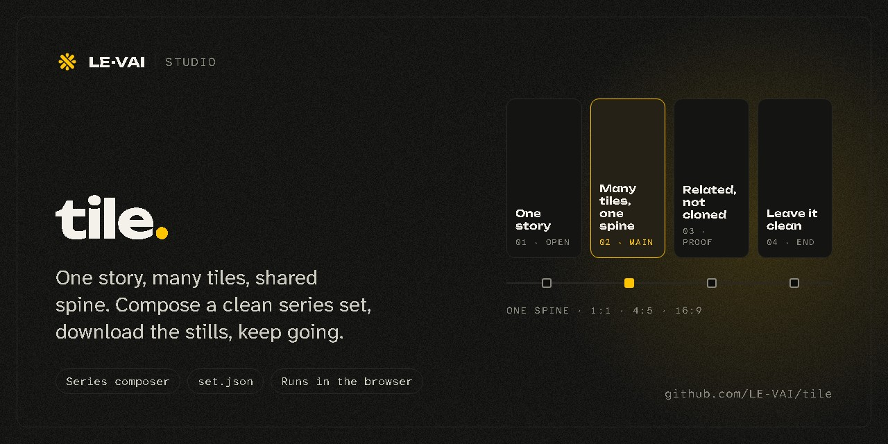
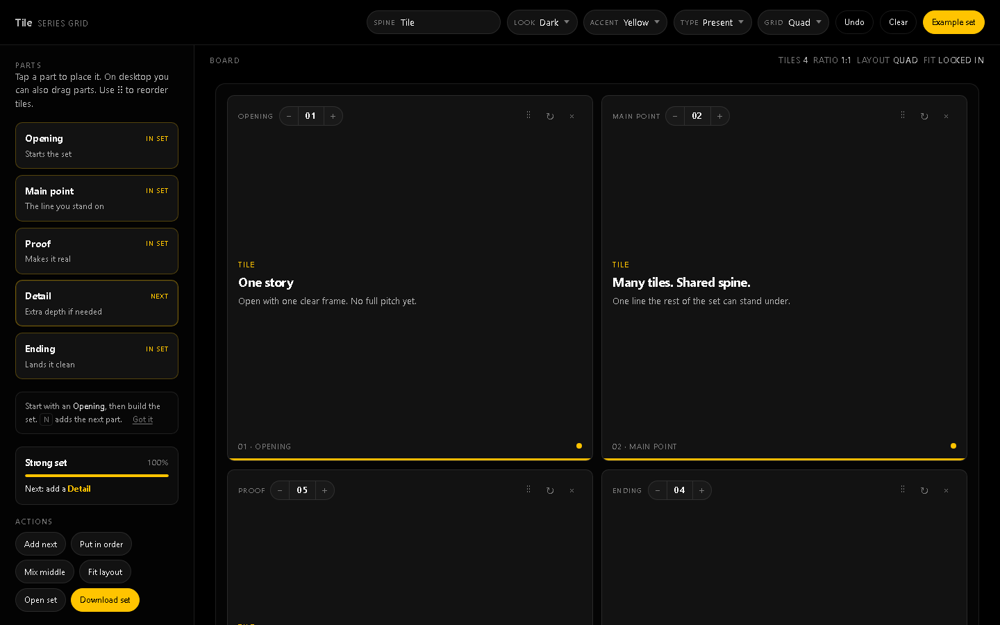

# Tile

  

**One story. Many tiles. Shared spine.** Tile composes a series set: a run of images that tell one story across several tiles while sharing one title, one look and one accent, so the set reads as related without any tile being a clone of another.

**[Open Tile →](https://le-vai.github.io/tile/)**

## The board

  

- **Parts.** A set is built from parts with a job each: *Opening* starts the set, *Main point* is the line you stand on, *Proof* makes it real, *Detail* adds depth if needed, *Ending* lands it clean. A strength meter tells you what the set still needs.
- **Spine.** One title runs across every tile. Look, accent, type and grid are set once for the whole set.
- **Ratios.** 1:1, 4:5 and 16:9.
- **Actions.** Add next, Put in order, Mix middle, Fit layout.

## Save and reopen

**Download set** saves a `.zip` with every tile as a PNG and a `set.json` that describes the whole set. **Open set** reads that `set.json` back, so you can keep going where you stopped.

## Run it yourself

Tile is one static page. Clone the repo and open `index.html`, or serve the folder with any static server.

## License

MIT. See [LICENSE](LICENSE).
